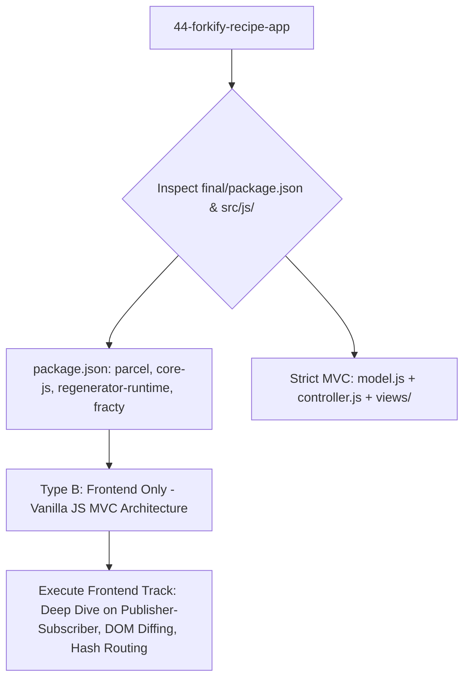

# Project Type Pre-Check: 44-Forkify-Recipe-App

## Step 0 Pre-Check Analysis

- **Detected Track**: **Track B: Frontend Only (Modern Vanilla JavaScript Single-Page Application with MVC Architecture)**
- **Project Root**: `/Users/avishjain/avishjain9-repos/44-forkify-recipe-app`
- **Application Directory**: `ForkifyRecipeApp-Clean-Project/18-forkify/final/`
- **Primary Domain**: Gourmet recipe discovery, dynamic ingredient portioning, custom recipe publishing, and persistent bookmarking platform consuming the external Forkify v2 REST API.

### Evidence Matrix

| Evidence Factor | Codebase Artifact | Concrete Findings | Verdict |
|---|---|---|---|
| **Package Dependencies** | `final/package.json` | `core-js@^3.24.1`, `fracty@^0.0.3`, `regenerator-runtime@^0.13.9`, `parcel@^2.6.2` | Client-side ES6+ polyfilling and bundling; no Node/Express server runtime. |
| **Backend Code** | Entire Repository | No server listeners or custom API routes. All network calls consume `https://forkify-api.jonas.io/api/v2/recipes/`. | **Not applicable** (Skip custom backend server sections). |
| **Database Layer** | `final/src/js/model.js` | Browser `window.localStorage` persists bookmark IDs and user recipes. Zero MongoDB/SQL. | **Not applicable** (Client-side storage architecture). |
| **Application Architecture** | `final/src/js/` | Separation of Model (`model.js`), View (`views/View.js`), and Controller (`controller.js`) via Publisher-Subscriber pattern. | Enterprise-grade Vanilla JS architectural design. |

### Document Adaptation Strategy

1. **Frontend Focus**: Deep dive into the Publisher-Subscriber event pattern, fine-grained DOM diffing algorithm (`update()` in `View.js`), fractional portion calculation (`fracty`), async AJAX wrappers with race timeouts (`helpers.js`), and browser hash routing (`hashchange`).
2. **Database & Server Sections**: Marked explicitly as `Not applicable for this project type (Frontend-only client application consuming external REST API)`.
3. **AI Pipeline**: Documented as `No AI integration present in repository`. Provided architectural blueprint for an AI Recipe Assistant & Nutrition Analyzer.
4. **Master Checklist**: All 275 items evaluated with strict adherence to real code citations or explicit "Not applicable" justifications.
