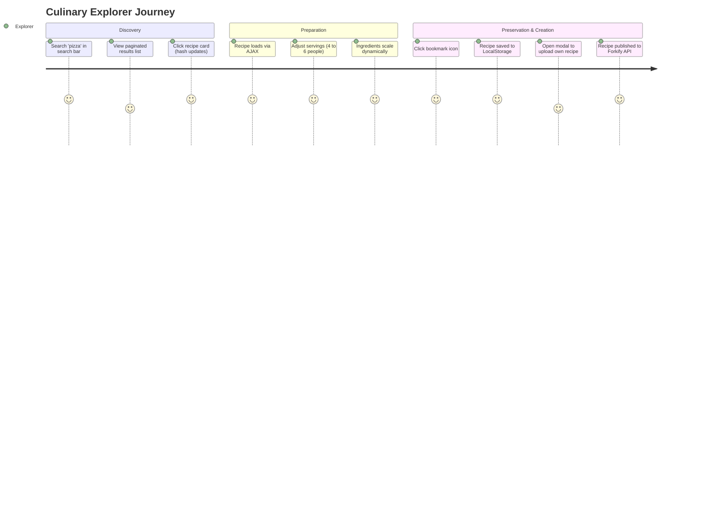
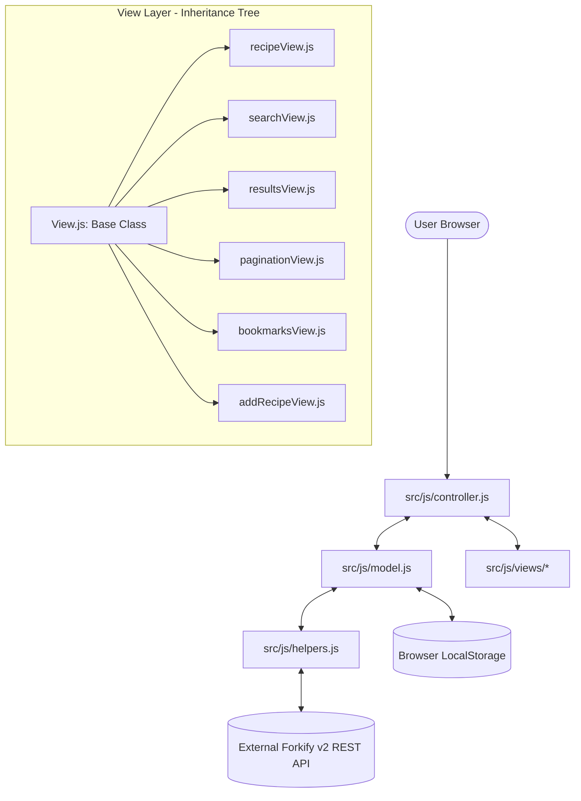
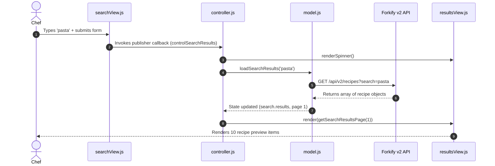

# Full Project Analysis: Forkify Recipe App

## 0.1 What the Project Is

**Forkify** is a modern culinary application designed to solve recipe discovery, portion scaling, and recipe management friction. Built without heavy UI libraries like React or Vue, Forkify proves that enterprise-level architecture—incorporating bidirectional data flow, virtual DOM element diffing, and state synchronization—can be achieved using pure modern Vanilla JavaScript (ES6+).

### Main User Journeys



---

## 0.2 Master Feature Inventory & Traces

### System Overview Diagram



### F1: Recipe Search & Paginated Discovery
- **User Action**: Enters culinary query (e.g., "pasta") into search input; presses Enter. Spinner appears, followed by 10 recipe cards on page 1 with pagination controls.
- **Trace**: `searchView.js:L12` (`addHandlerSearch`) -> `controller.js:L36` (`controlSearchResults`) -> `model.js:L53` (`loadSearchResults`) -> `helpers.js:L15` (`AJAX`) -> `resultsView.js:L8` (`render`) -> `paginationView.js:L8` (`render`).
- **Data Flow**: `GET https://forkify-api.jonas.io/api/v2/recipes?search=pasta&key=<KEY>`.



### F2: Deep-Linked Recipe Rendering with Hash Routing
- **User Action**: Clicking any recipe item updates the window URL hash (e.g., `/#5ed6604591c37cdc054bc886`); the central pane loads detailed cooking time, ingredients with fractional portions, and source URL.
- **Trace**: `window.addEventListener('hashchange', controlRecipes)` in `recipeView.js:L35` -> `controller.js:L19` (`controlRecipes`) -> `model.js:L24` (`loadRecipe`) -> `recipeView.js:L50` (`render`).

### F3: Real-Time Servings Adjustment & Granular DOM Diffing
- **User Action**: User clicks the `+` or `-` button next to servings count (e.g., from 4 to 6 servings); ingredient quantities scale proportionally without full-page re-rendering or image flashing.
- **Trace**: `recipeView.js:L40` (`addHandlerUpdateServings`) -> `controller.js:L61` (`controlServings`) -> `model.js:L75` (`updateServings`) -> `recipeView.js:L30` (`update`).
- **DOM Diffing Algorithm (`View.js:L30`)**: Creates virtual DOM fragment using `document.createRange().createContextualFragment(newMarkup)`. Iterates all nodes comparing `curEl.isEqualNode(newEl)`. Updates text content only when `newEl.firstChild?.nodeValue.trim() !== ''`, and copies attributes (`newEl.attributes`).

```mermaid
flowchart TD
    ClickPlus[Click '+' Servings Button] --> Handler[recipeView.addHandlerUpdateServings]
    Handler --> CtrlServings[controller.controlServings(newServings)]
    CtrlServings --> ModelUpdate[model.updateServings: Scales ingredient.quantity]
    ModelUpdate --> VDOM[View.prototype.update: Generates newMarkup fragment]
    VDOM --> NodeLoop[Loop curElements vs newElements]
    NodeLoop --> DiffCheck{!curEl.isEqualNode(newEl)?}
    DiffCheck -->|Yes & Text Changed| UpdateText[curEl.textContent = newEl.textContent]
    DiffCheck -->|Yes & Attr Changed| UpdateAttr[Sync element attributes dataset/class]
    DiffCheck -->|No| Skip[Retain current DOM node untouched]
```

### F4: Persistent Bookmarks Engine
- **User Action**: User clicks the bookmark icon on any recipe; recipe is saved to a dropdown bookmark list and stored in browser `localStorage`. On page reload, bookmarks persist.
- **Trace**: `recipeView.js:L45` (`addHandlerAddBookmark`) -> `controller.js:L68` (`controlAddBookmark`) -> `model.js:L89` (`addBookmark` / `deleteBookmark`) -> `bookmarksView.js:L10` (`update`).

### F5: Custom Recipe Creator & Publisher
- **User Action**: User clicks "ADD RECIPE" navigation button; modal window opens with 6 ingredient fields and metadata inputs; submits form. Recipe is POSTed to the Forkify API, assigned an API key, bookmarked, and URL hash updated.
- **Trace**: `addRecipeView.js:L30` (`addHandlerUpload`) -> `controller.js:L84` (`controlAddRecipe`) -> `model.js:L115` (`uploadRecipe`) -> `helpers.js:L15` (`AJAX POST`) -> `recipeView.render`.

---

## 0.3 Final Inventory Counts

| Architectural Metric | Count | Code Verification Reference |
|---|---|---|
| **JavaScript Modules** | 12 | `controller.js`, `model.js`, `helpers.js`, `config.js`, + 8 View classes |
| **Inherited View Classes** | 7 | `recipeView`, `searchView`, `resultsView`, `paginationView`, `bookmarksView`, `addRecipeView`, `previewView` |
| **Base Class** | 1 | `View.js` (`render`, `update`, `renderSpinner`, `renderError`, `renderMessage`) |
| **External REST Endpoints Consumed** | 3 | `GET /recipes/:id`, `GET /recipes?search=query`, `POST /recipes?key=KEY` |
| **Storage Keys** | 1 | `localStorage.getItem('bookmarks')` in `model.js:L109` |
| **Dependencies / DevDependencies** | 6 | `core-js`, `fracty`, `regenerator-runtime`, `parcel`, `@parcel/transformer-sass` |
