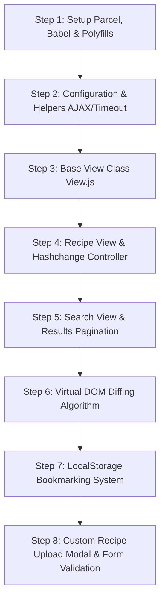

# Step-by-Step Rebuild Guide: Forkify Recipe App

Constructing Forkify from scratch in strict architectural dependency order:



### Key Snippet: Custom AJAX Engine with Promise.race Timeout (`src/js/helpers.js`)

```javascript
import { TIMEOUT_SEC } from './config.js';

const timeout = function (s) {
  return new Promise(function (_, reject) {
    setTimeout(function () {
      reject(new Error(`Request took too long! Timeout after ${s} second`));
    }, s * 1000);
  });
};

export const AJAX = async function (url, uploadData = undefined) {
  try {
    const fetchPro = uploadData
      ? fetch(url, {
          method: 'POST',
          headers: {
            'Content-Type': 'application/json',
          },
          body: JSON.stringify(uploadData),
        })
      : fetch(url);

    const res = await Promise.race([fetchPro, timeout(TIMEOUT_SEC)]);
    const data = await res.json();

    if (!res.ok) throw new Error(`${data.message} (${res.status})`);
    return data;
  } catch (err) {
    throw err;
  }
};
```
