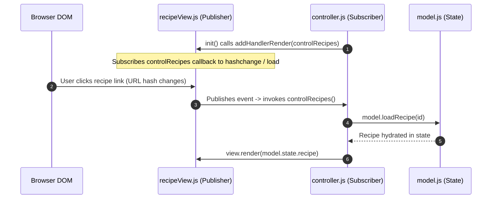

# Architecture & System Design: Forkify Recipe App

## High-Level Architecture Overview

Forkify is designed around the classic **Model-View-Controller (MVC)** architectural pattern combined with the **Publisher-Subscriber** event delegation pattern.

```mermaid
flowchart TD
    subgraph ViewLayer[View Layer (src/js/views/)]
        RecipeView[recipeView.js]
        SearchView[searchView.js]
        ResultsView[resultsView.js]
        PaginationView[paginationView.js]
        BookmarksView[bookmarksView.js]
        AddRecipeView[addRecipeView.js]
        BaseView[View.js: Base Class]
        RecipeView --> BaseView
        ResultsView --> BaseView
        PaginationView --> BaseView
        BookmarksView --> BaseView
        AddRecipeView --> BaseView
    end

    subgraph ControllerLayer[Controller Layer]
        Controller[src/js/controller.js]
    end

    subgraph ModelLayer[Model Layer]
        Model[src/js/model.js: Application State]
        Helpers[src/js/helpers.js: AJAX + Promise.race]
        Config[src/js/config.js: Constants]
    end

    User([User]) -->|DOM Event: Click / Submit| ViewLayer
    ViewLayer -->|Publishes Event to Handler| ControllerLayer
    ControllerLayer -->|Mutates State / Calls Action| ModelLayer
    ModelLayer -->|Returns State Data| ControllerLayer
    ControllerLayer -->|Dispatches New Data to render/update| ViewLayer
    ViewLayer -->|DOM Diffing / InnerHTML| User
```

---

## Publisher-Subscriber Event Pattern

In traditional applications, views often directly import controllers or controllers query DOM elements. Forkify avoids this anti-pattern using Publisher-Subscriber:


