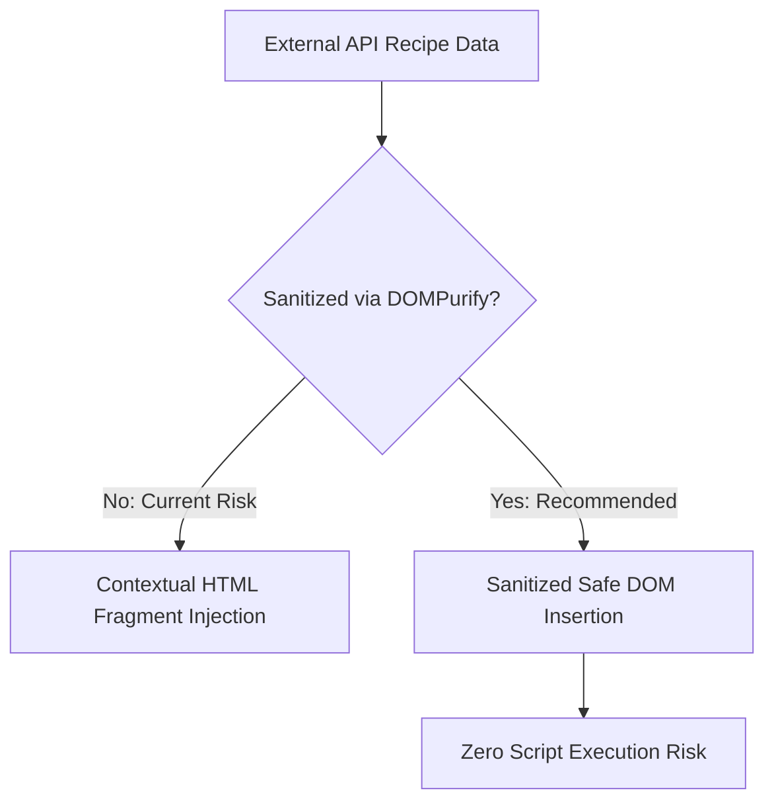

# Security Audit & Hardening Matrix: Forkify

## OWASP Top 10 Evaluation for Vanilla Client App

| Threat Category | Severity in Forkify | Implemented Protection | Recommended Hardening |
|---|---|---|---|
| **A03: Injection (XSS)** | High | Static HTML structure with parameterized data strings. | Sanitize external recipe titles and descriptions using `DOMPurify` before injecting into DOM templates. |
| **A07: Identification Failures** | Medium | User custom recipes secured by personal API developer key in query params. | Migrate to OAuth2 Bearer tokens stored in HttpOnly secure session cookies. |
| **A08: Software Integrity** | Low | Dependencies managed with locked `package-lock.json`. | Run periodic `npm audit` to patch known Parcel / Babel vulnerabilities. |
| **API Secret Exposure** | Medium | Developer `KEY` currently defined in client-side `config.js`. | Route recipe uploads through a lightweight backend proxy (e.g. Netlify / Vercel Edge Function) to conceal keys. |

