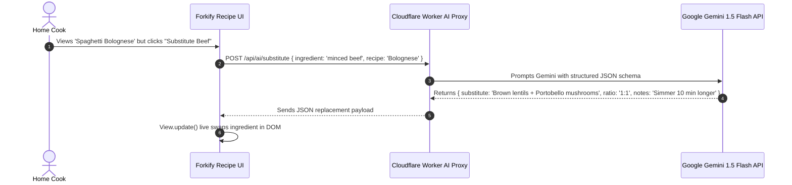

# AI Integration Analysis: Forkify Recipe App

## Current Status: No AI Integration

The repository currently contains **No AI integration**. Forkify relies on structured REST data returned from the external Forkify v2 API.

---

## Architectural Blueprint: AI Sous Chef & Smart Ingredient Substitutions

### Proposed AI Capabilities
1. **AI Ingredient Substitution**: Automatically suggests allergen-friendly or dietary swaps (gluten-free, vegan) for any recipe ingredient.
2. **Nutritional Estimation**: Predicts calories, macronutrient splits (protein, fats, carbs), and glycemic index from unstructured ingredient text.
