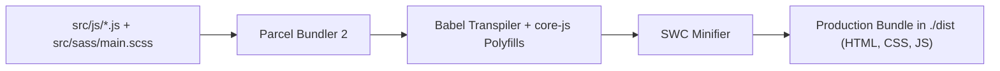

# Engineering Quality & Operations: Forkify

## Build & Toolchain Automation

Encapsulated in `ForkifyRecipeApp-Clean-Project/18-forkify/final/package.json`:

```json
{
  "scripts": {
    "start": "parcel index.html",
    "build": "parcel build index.html --dist-dir ./dist"
  }
}
```


