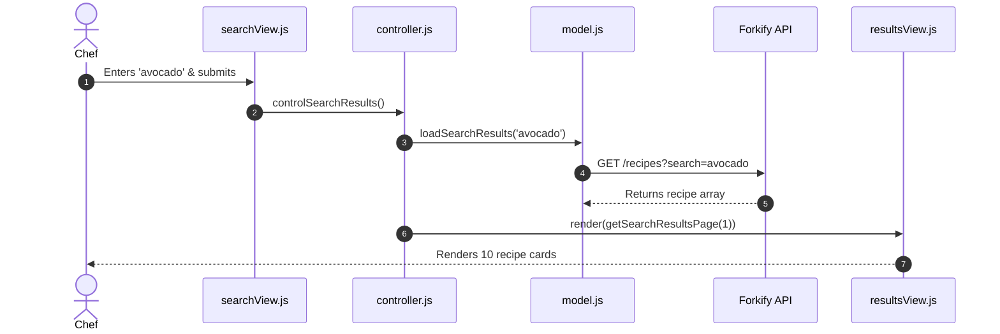

# F1: Recipe Search & Paginated Discovery

## Overview & Architecture
Enables users to search thousands of recipes from the Forkify API, displaying 10 results per page with forward and backward pagination buttons.

## Say It Out Loud
> "I implemented the recipe search feature using the Publisher-Subscriber pattern in `searchView.js` and `controller.js`. When the user submits a search query, `searchView` extracts the input value and publishes an event to `controlSearchResults`. The controller triggers a loading spinner and invokes `model.loadSearchResults`, which fetches data from the Forkify API using our custom AJAX wrapper. Once received, the model stores the results in state and resets the pagination offset to page one. The controller then slices the first ten results and instructs `resultsView` and `paginationView` to render, enabling seamless browsing without full page refreshes."
