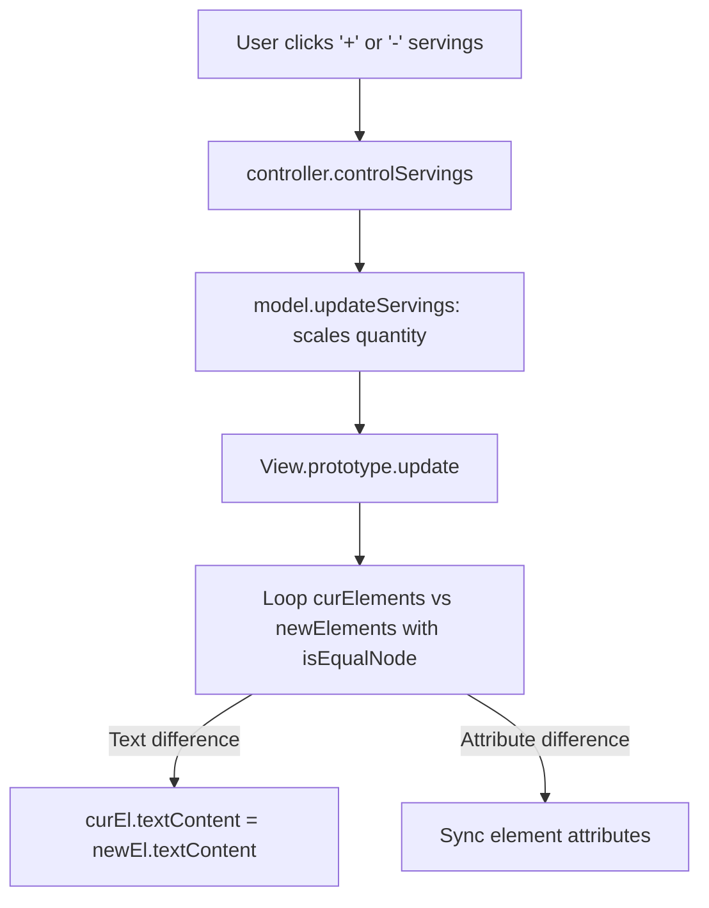

# F3: Portion Scaling & Virtual DOM Diffing Engine

## Overview & Architecture
Recalculates ingredient quantities proportionally and uses an in-memory virtual DOM diffing algorithm to update only changed text and attribute nodes.

## Say It Out Loud
> "To adjust recipe servings dynamically, I built an ingredient scaling engine in `model.js` paired with an in-house DOM diffing algorithm in `View.js`. When the user clicks the plus or minus servings button, the model recalculates every ingredient quantity using linear proportional scaling. Instead of calling `innerHTML` to rebuild the entire recipe pane—which causes visible image flickering and destroys focus—I implemented `View.prototype.update`. It generates an off-screen virtual DOM fragment, loops through every child node comparing them with `isEqualNode()`, and updates only the exact text nodes and attributes that changed. The UI updates in under sixteen milliseconds with zero layout jank."
