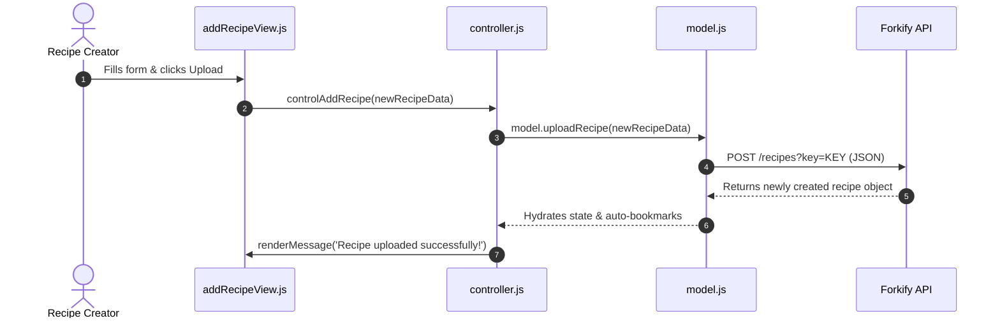

# F5: Custom Recipe Creator & Publisher

## Overview & Architecture
Modal window allowing home cooks to author custom recipes, formatting ingredients and POSTing to the Forkify API.

## Say It Out Loud
> "The custom recipe creator in `addRecipeView.js` empowers home cooks to publish their own recipes. The view captures form submissions using the native `FormData` API and passes an array of key-value pairs to `controlAddRecipe`. In `model.js`, I validate and transform the six ingredient strings into structured objects containing quantity, unit, and description. The model then executes a POST request to the Forkify API containing the developer API key. Once confirmed by the API, the recipe is immediately bookmarked, rendered to the main view, and the modal smoothly closes after a two-and-a-half-second success message."
