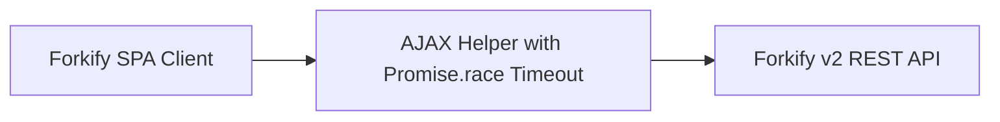

# 14.9: Reliability And Resilience

## 1. Overview & Context in Forkify
This module analyzes `reliability-and-resilience` applied specifically to the Forkify Vanilla JS MVC platform.

## 2. Technical Evaluation & Comparison
| Strategy / Pattern | Chosen Implementation | Alternative A | Alternative B | Trade-Off Accepted |
|---|---|---|---|---|
| **Data Fetching** | Custom AJAX with `Promise.race` timeout | Axios library | Native `fetch` without timeouts | Avoided third-party library bloat while safeguarding against hanging requests. |
| **DOM Synchronization** | Granular Element-by-Element DOM Diffing | Full `innerHTML` re-render | React Virtual DOM library | Sub-16ms update speed with zero runtime library footprint. |

## 3. Spoken 30-Second Interview Response
> "In Forkify, reliability and resilience is handled by leveraging standard browser primitives with enterprise architectural rigor. By using Promise.race with a ten-second timeout, the client guarantees fast failure states on slow mobile networks. Furthermore, our fine-grained DOM diffing algorithm minimizes layout thrashing, delivering smooth 60 FPS portion scaling."
